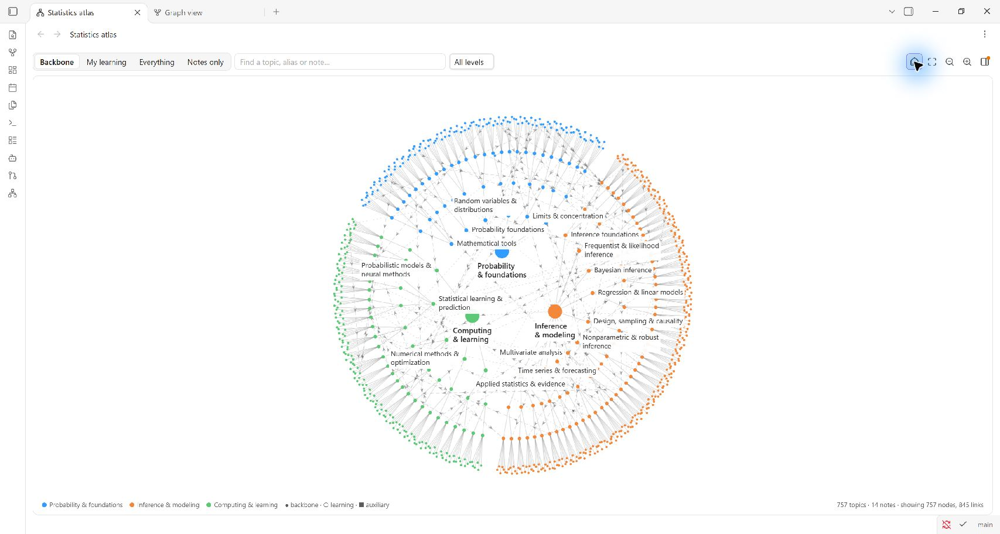
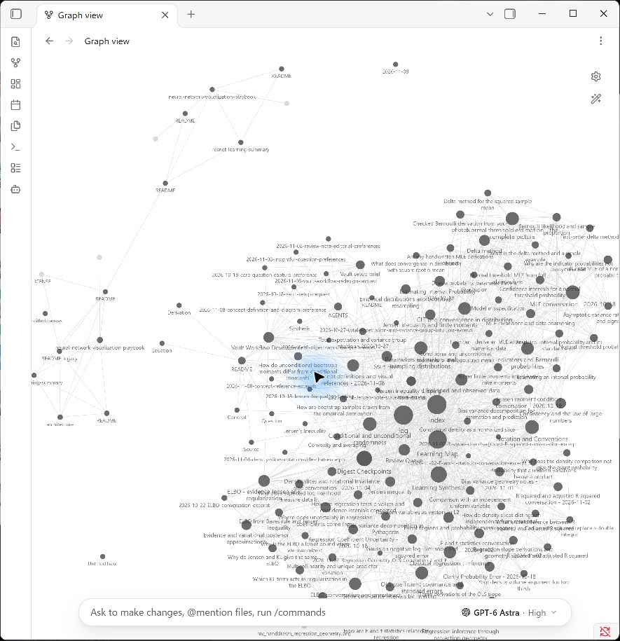
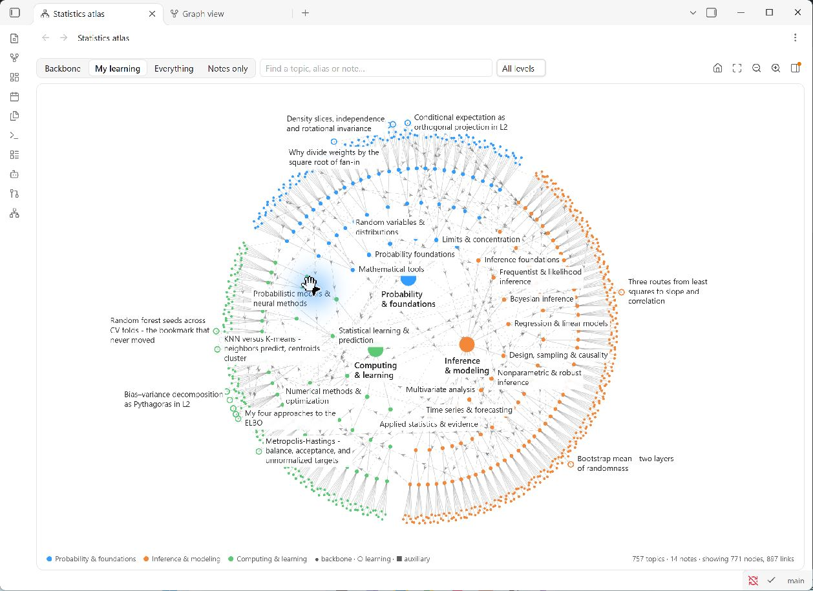
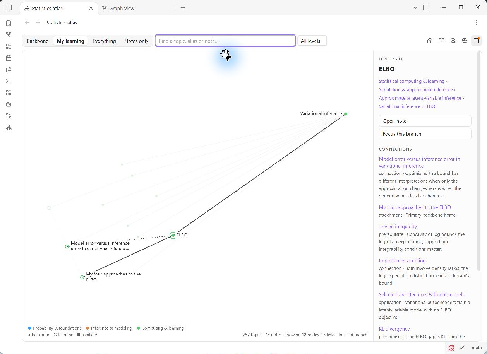

# Statistics Atlas

A statistics and machine-learning study vault for **Obsidian**, with a map that shows where an idea belongs and how it connects to other ideas.

The vault combines a five-level topic backbone, personal learning notes, original handwriting and sources, and a small custom map plugin. You can explore everything locally. An AI agent is optional.



*The whole backbone. Blue is probability and mathematical foundations, orange is statistical inference and modeling, and green is statistical computing and learning. Start with the large subjects, then zoom toward a chapter or individual topic.*

## Why I built this

In my old `stats_ML` vault, I linked concepts, equations, questions, sources, indexes, and maintenance pages. The notes were useful, but the graph became difficult to read. There were many lines, and I could not easily tell which ones explained a mathematical relationship.

Obsidian's native graph shows links between files. A link to a source, a navigation page, and a prerequisite can all look similar. A heavily linked index also becomes visually prominent, even though it is not a central statistical idea. Filters and colors help, but I wanted the structure of the subject to stay visible as my notes grew. See [how Obsidian's native graph works](https://help.obsidian.md/plugins/graph).



*The original vault's native graph. This shows the starting point for the redesign; it is a different vault with different content, not a controlled comparison of two layouts.*

I built **Statistics Atlas** around three simple choices:

- Give each topic a stable place in the subject hierarchy.
- Attach each personal note to one main topic, while allowing useful connections elsewhere.
- Explain each connection in a sentence, and show sources and administration only when requested.

The native graph is still available. The Atlas is an additional view made for this learning workflow.

## Open it in your Obsidian

1. Install [Obsidian](https://obsidian.md/download). A current desktop version is the easiest starting point.
2. On this repository, choose **Code → Download ZIP**, then extract the ZIP. Or clone it:

   ```sh
   git clone https://github.com/liuhon33/statistics-atlas.git
   ```

3. In Obsidian's vault switcher, choose **Open folder as vault**. Select the extracted or cloned folder containing `Start Here.md`, `Backbone`, `Learning`, and `.obsidian`.
4. Open **Settings → Community plugins**. If you trust the included plugin, turn on community plugins and enable **Statistics atlas** in the installed list.
5. Open the command palette with **Ctrl+P** on Windows/Linux or **Cmd+P** on macOS. Run **Statistics atlas: Open statistics atlas**. You can also use its network icon in the left ribbon.
6. Open **Start Here** for the short in-vault guide.

The working plugin is included in `.obsidian/plugins/statistics-atlas/`. There is no build step and no Python, Node.js, AI subscription, or Obsidian Publish subscription needed to browse the vault. The Markdown notes also work with the plugin disabled; the custom map, live `atlas` blocks and embedded interactive figures need the plugin.

**Keep the whole folder together.** `.obsidian` may be hidden by your file manager. On Windows, use a short location such as `C:\atlas` because the topic folders are deeply nested. Open this as its own vault first; placing it inside another vault changes the root used by its links and layout file. [Obsidian's folder-opening guide](https://help.obsidian.md/manage-vaults) explains the same setup.

## Explore the views

| View | What you see | When to use it |
| --- | --- | --- |
| **Backbone** | The topic hierarchy and connections between topics. | Find where an idea fits in statistics. |
| **My learning** | The backbone plus personal notes attached to their main topics. | Connect what you studied to the larger subject. |
| **Notes only** | Personal notes and links between those notes. | Review your own work with fewer dots. |
| **Everything** | The topics, notes, sources, and administrative records. | Trace an explanation back to its evidence. |



*My learning: the topic map stays in place, and hollow circles around its outside show personal notes. For example, the ELBO derivations sit near variational inference, while the bootstrap note sits near nonparametric inference.*

Switching views keeps the topic positions and camera. Press **Fit visible** if newly shown notes or sources sit outside the current screen. Use **Whole web** to clear a branch focus and return to the overview.

On a topic page, a **My notes** strip under the title links the personal notes attached there and counts those in its sub-topics. Press **Ctrl+Shift+L** (**Cmd+Shift+L** on macOS) on any topic page, or with a topic selected in the map, to search and open one of those notes. Enter opens it in place; Ctrl/Cmd+Enter opens a new tab. Change the key in **Settings → Hotkeys** under **Statistics atlas: Open a learning note attached to this page**. To start a new note on that topic, press **Ctrl+Alt+N** (**Cmd+Alt+N**, command **Statistics atlas: New learning note here**) and type a title. It creates an empty draft attached to the topic, with the folder and properties filled in. Add your explanation yourself or ask an agent to help, then review it before using `approve`.

### Try the ELBO example

1. Choose **My learning**.
2. Type `ELBO` in the search box and select **ELBO · L5**.
3. Open the right-hand panel if it is hidden. Read the path and the reasons under **Connections**.
4. Select **My four approaches to the ELBO**, then **Open note** to read the derivations and original handwriting.



*The focused branch shows ELBO, its place under variational inference, and related personal notes. The panel also lists connections to topics outside the focused branch: Jensen's inequality, KL divergence, importance sampling, and latent-variable models.*

For example, Jensen's inequality helps derive the lower bound, while KL divergence explains the gap between that bound and the log evidence. The connection text tells you why each topic matters.

### Explore an idea with sliders

Open the Fisher information, CI/p-value, or CLT/delta-method note in Reading view or rendered Live Preview. The included Statistics Atlas plugin shows sliders and linked plots directly inside the note: move a candidate null, change a sample size, or compare a distribution with its approximation. The conditional-probability and total-expectation pages also share a rotatable joint-density explorer. These figures run offline, include static alternatives, and provide a standalone HTML file you can open in a browser. No additional plugin or server is required.

### A few useful controls

- **Click a dot** to select it and inspect its connections. **Double-click** to open its note.
- **Search** by title or alias to focus a topic. Clicking a topic in the panel follows that connection.
- **Scroll** to zoom and **drag** to pan.
- Use **Visible levels** to show just the broad subjects or progressively more detail.
- Open **Map checks** to inspect missing homes, unresolved links, or topics needing a saved position.

Solid lines show the hierarchy or a note's main attachment. Dashed lines with chevrons show prerequisites or applications. Dotted lines show other conceptual connections. A topic being inside a chapter does not, by itself, mean it is a prerequisite for every other topic there.

## Study with an agent

An agent can help turn a conversation, paper, screenshot, or handwritten solution into a note. You still choose what to save and review the result.

### Put the agent inside Obsidian

The optional [Claudian plugin](https://github.com/YishenTu/claudian) adds an agent chat panel to Obsidian. It is a separate project from Statistics Atlas.

1. Install and sign in to a supported agent runtime, such as Claude Code or Codex, following that provider's setup guide.
2. In Obsidian, open **Settings → Community plugins → Browse**, search for **Claudian**, install it, and enable it.
3. Open Claudian from the ribbon or command palette. Select your installed provider and configure its executable path if it is not found automatically.
4. Start with: **“Read AGENTS.md and _system/Build status.md. Help me study without saving anything yet.”**

Claudian currently requires desktop Obsidian 1.13.0 or later and a compatible agent account or API provider. Your agent's account and usage are separate from this vault. Review the notes it writes before approving them. See the [Claudian setup and troubleshooting guide](https://github.com/YishenTu/claudian#requirements).

You can also use an agent outside Obsidian: open this vault folder as its working project, read `AGENTS.md`, and keep Obsidian open to review the notes it writes.

### Use the included skills

A **skill** is a saved set of instructions for a repeated task. The shared copies live in [`.agents/skills`](.agents/skills). These commands belong to the agent; typing them into an ordinary Obsidian note does not run them.

| Command | What it does |
| --- | --- |
| `digest` | Turns one source or the new part of a conversation into one coherent learning note. |
| `chop` | Splits a source covering several substantial topics into a few notes. |
| `extend` | Adds new material to an existing learning note. |
| `connect` | Suggests useful links between existing learning notes; you choose which to keep. It can also add small inline pointers without changing the map. |
| `enrich` | Develops a backbone topic in stages: a quick introduction, the main formulas, then deeper connections. |
| `enrich-initial` | Adds or improves only the one-minute introduction and its visual. |
| `add-backbone` | Proposes and adds a missing topic in the right place. |
| `approve` | Finalizes and commits the work you have reviewed. It does not publish it. |

The supporting `animate-geometry` skill helps the agent make checked mathematical diagrams, animations and offline interactive figures with linked plots and sliders, with code you can rerun.

There is also an optional `forget_claudian` housekeeping skill for deleting old local Claudian chat records after confirmation. It is not part of studying or saving notes.

In Codex CLI or its IDE extension, type `$digest` or select it through the skill picker. Codex discovers this repository's `.agents/skills` directory. In Claudian, use the `/` or `$` menu for your selected provider. Plain requests such as **“digest this”** also work when the agent follows `AGENTS.md`. [Official Codex skill documentation](https://learn.chatgpt.com/docs/build-skills#where-codex-loads-local-skills).

For Claude Code, expose the same skills at `.claude/skills` using Claudian's skill synchronization. If that folder is absent, a local junction on Windows or a symlink on macOS/Linux can point to `.agents/skills`; do not replace an existing skills directory. `AGENTS.md`, section 14, explains the shared-folder arrangement.

### An example session

```text
Explain why the ELBO can be derived using both Jensen's inequality and KL divergence.
Use the existing notes as building blocks. Don't save anything yet.

[Discuss the ideas, check the algebra, and attach relevant handwriting.]

digest this. Keep the comparison between the two derivations and my final diagram.

[Read the draft in Obsidian and request any corrections.]

approve the ELBO note.
```

Ordinary discussion stays in the chat. `digest` saves only the new material since that chat's last completed digest. It preserves originals, checks the mathematics, chooses one main topic, and explains useful connections. The result is a draft for you to review. A repeat digest should not duplicate old material.

For a fresh ZIP download, initialize Git in your own copy if you want `approve` to create commits. If you plan to publish your own study notes, use your own repository and review what you share.

## How the plugin works

The notes are ordinary Markdown files. Their properties tell the plugin what to draw:

| Property | Plain-language meaning |
| --- | --- |
| `layer` | Is this a backbone topic, a personal learning note, or an auxiliary record? |
| `parent` | Which broader topic contains this backbone topic? |
| `primary_home` | Where does this personal note belong? |
| `prerequisite_for` | Which topic needs this idea first? |
| `applied_in` | Where is this idea used? |
| `related` | Which other backbone idea is conceptually connected? |
| `connections` | Which extra topics or notes help explain this learning note? |
| `sources` | Where did the material come from? |

The map reads these properties and the written reasons for connections. A casual link in the body of a note does not automatically become a conceptual edge. `_system/layout.json` stores stable positions, so adding personal notes does not rearrange the backbone. A new backbone topic needs an agreed saved position; until then, the map marks its placement as provisional.

The empty `atlas` blocks in backbone pages show live lists of child topics, incoming connections, and attached personal notes. The plugin builds those lists when you view the page. It does not write them back into your notes.

The Atlas itself runs locally and makes no network requests. Viewing the map and its note lists does not edit your files. The **New learning note here** command creates an empty draft only when you ask it to; the plugin does not generate explanations or change original sources. Properties and source details start collapsed so the explanation is easier to read; you can expand them whenever you need them. Optional AI plugins have their own data handling. The source code is in [`_system/plugin-src`](_system/plugin-src), and the ready-to-run bundle is in [`.obsidian/plugins/statistics-atlas`](.obsidian/plugins/statistics-atlas).

## What is included

| Folder | Contents |
| --- | --- |
| `Backbone/` | 760 topic pages, arranged from broad subjects to individual concepts. |
| `Learning/` | 30 personal learning notes, including ELBO, diffusion, Fisher information, CLT and delta method, MLE, bootstrap, regression, test geometry, confidence intervals, and attention. |
| `raw/` | Preserved original sources, screenshots, and handwriting. |
| `assets/figures/` | Explanatory figures and their reproducible source. |
| `_system/` | Catalogs, references, layout, workflow records, templates, and tools. |
| `.agents/skills/` | Shared instructions for digesting, extending, connecting, and reviewing notes. |
| `.obsidian/plugins/statistics-atlas/` | The custom map plugin, already built. |

These counts describe the public update on **2026-11-11**. Many backbone pages are topic scaffolds; 760 pages does not mean 760 complete lessons. Migration from the old vault is still in progress. See the [build status](_system/Build%20status.md) and [migration coverage report](_system/Migration%20coverage%20audit%20-%202026-11-09.md).

The public copy includes the rebuilt vault's content and tools. Local agent sessions, account settings, window layouts, debug logs, and unrelated installed plugins are excluded. Install optional plugins through their own projects. Original sources keep their individual attribution; public availability is not a blanket license to redistribute third-party material.

## Troubleshooting and development

- **No Statistics atlas command:** confirm `.obsidian/plugins/statistics-atlas/` contains `main.js`, `manifest.json`, and `styles.css`, then enable the plugin and restart Obsidian.
- **The map seems incomplete:** choose **Whole web**, set **All levels**, then **Fit visible**. Try **Statistics atlas: Refresh statistics atlas** after a large import.
- **A note does not appear:** check its `layer: learning`, valid `primary_home`, and the current view or branch filter.
- **Opening only the plugin gives an error:** it also needs this vault's notes and `_system/layout.json`. Open the complete vault.
- **Skills do not appear:** make the vault root the agent's working folder, check `.agents/skills`, and restart the agent. Claude Code also needs the shared-folder setup described above.

Screenshots show the **2026-11-09** snapshot in Obsidian 1.15.0 on Windows. The current version includes more notes and the navigation controls described above. The Atlas manifest allows mobile, but this publication was checked on desktop; mobile behavior has not been verified.

<details>
<summary>For developers: rebuild and validate</summary>

Only editing the plugin or running the maintenance checks needs developer tools: Python 3.10+ with PyYAML, and Node.js 18+.

```sh
python -m pip install PyYAML
python _system/tools/build_plugin.py
python _system/tools/build_plugin.py --check
python -X utf8 _system/tools/validate.py .
python -X utf8 _system/tools/test_validate.py
```

For the model and refresh checks, export to a temporary path outside the vault and pass that same path to both tests:

```sh
python -X utf8 _system/tools/validate.py . --export ../atlas-check.json
node _system/tools/test-model.cjs ../atlas-check.json
node _system/tools/test-refresh.cjs ../atlas-check.json
node _system/tools/test-fold-properties.cjs
python -X utf8 _system/tools/test_fold_note_provenance.py
```

Reload the plugin or restart Obsidian after rebuilding. `build_vault.py` is the historical initial generator; do not run it over an edited vault. The current notes, rather than the frozen baseline dataset, are the authority.

The existing validation warnings identify three repeated display titles with distinct filenames and provisional positions for four added topics: Law of total expectation, Attention mechanisms, Cauchy distribution, and Hilbert spaces. See the [review queue](_system/Review%20Queue.md) for details.

</details>
